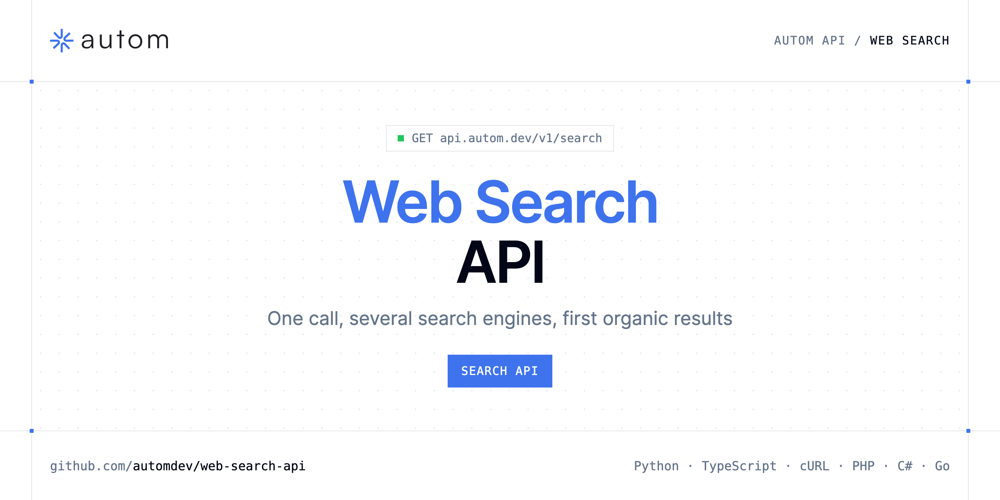

<p align="center">
  <a href="https://www.autom.dev"></a>
</p>

# Web Search API

[](https://discord.gg/CFj3ph8aHU) [](https://app.autom.dev/register) [](https://docs.autom.dev) [](LICENSE)

The **Autom Web Search API** walks search engines in order and returns the first organic results it gets. With `engines=auto` it tries Google, then Brave, Bing, DuckDuckGo, Yahoo and Baidu; pass a comma-separated list to choose the order.

- **Search API** — One call walks engines in order and returns the first organic results.

Use it for LLM grounding and AI agents that need one reliable search call instead of one integration per engine.

| Endpoint | Request | Credits |
|---|---|---|
| [Search API](#search-api) | `GET /v1/search` | 1 |

## Table of contents

- [How it works](#how-it-works)
- [Search API](#search-api)
- [Code examples in other languages](#code-examples-in-other-languages)
- [Use cases](#use-cases)
- [Why Autom?](#why-autom)
- [FAQ](#faq)
- [Related repositories](#related-repositories)
- [Support](#support)

## How it works

1. **Create a Autom account** and copy your API key from the [dashboard](https://app.autom.dev/register).
2. **Call `https://api.autom.dev`** with the header `x-api-key: YOUR_API_KEY`.
3. **Use the result** in your app — no infrastructure to run.

```bash
export AUTOM_API_KEY="your-api-key"
pip install requests        # Python
# TypeScript: Node.js 18+ (native fetch), run with `npx tsx file.ts`
```

## Search API

One call walks engines in order and returns the first organic results. engines=auto tries Google, then Brave, Bing, DuckDuckGo, Yahoo, and Baidu. Omitted gl is us and omitted hl is en. There is no page parameter: the response is always page 1. An empty query returns 400. If every engine misses, the call returns 404. Send header x-api-key. 1 credit on HTTP 200.

`GET https://api.autom.dev/v1/search` · **1 credit per request** · [API reference](https://app.autom.dev/openapi)

### Request parameters

| Parameter | In | Type | Required | Description |
|---|---|---|---|---|
| `query` | query | string | ✅ | Search query. |
| `engines` | query | string | — | Engine order. Default auto tries google, brave, bing, duckduckgo, yahoo, then baidu. A comma-separated list is followed as given. ddg and duck mean duckduckgo. Unknown names are ignored. |
| `gl` | query | string | — | Country code. Defaults to us when omitted. For example us, fr, gb, de. |
| `hl` | query | string | — | Language code. Defaults to en when omitted. For example en, fr, de. |

### Python example

```python
import os

import requests

API_KEY = os.environ["AUTOM_API_KEY"]
HEADERS = {"x-api-key": API_KEY}

response = requests.get(
    "https://api.autom.dev/v1/search",
    headers=HEADERS,
    params={
        "query": "openai",
    },
    timeout=120,
)
response.raise_for_status()

data = response.json()
print(data)
```

### TypeScript example

```typescript
type SearchApi = {
  organic_results?: {
    link?: string;
    title?: string;
    domain?: string;
    snippet?: string;
    position?: number;
    displayed_link?: string;
  }[];
  search_parameters?: {
    q?: string;
    gl?: string;
    hl?: string;
    page?: number;
    engine?: string;
    engines?: string[];
  };
};

const headers = { "x-api-key": process.env.AUTOM_API_KEY!, "Content-Type": "application/json" };

const params = new URLSearchParams({
  "query": "openai",
});

const response = await fetch(`https://api.autom.dev/v1/search?${params}`, { headers });
if (!response.ok) throw new Error(`HTTP ${response.status}: ${await response.text()}`);

const data = (await response.json()) as SearchApi;
console.log(data);
```

### Output example

Example response from the API reference, abridged.

```json
{
  "organic_results": [
    {
      "link": "https://openai.com/",
      "title": "OpenAI",
      "domain": "openai.com",
      "snippet": "OpenAI is an AI research and deployment company.",
      "position": 1,
      "displayed_link": "https://openai.com"
    }
  ],
  "search_parameters": {
    "q": "openai",
    "gl": "us",
    "hl": "en",
    "page": 1,
    "engine": "google",
    "engines": [
      "google",
      "brave"
    ]
  }
}
```

### Response fields

| Field | Type | Description |
|---|---|---|
| `organic_results[]` | object[] |  |
| `organic_results[].link` | string |  |
| `organic_results[].title` | string |  |
| `organic_results[].domain` | string |  |
| `organic_results[].snippet` | string |  |
| `organic_results[].position` | integer |  |
| `organic_results[].displayed_link` | string |  |
| `search_parameters` | object |  |
| `search_parameters.q` | string |  |
| `search_parameters.gl` | string |  |
| `search_parameters.hl` | string |  |
| `search_parameters.page` | integer |  |
| `search_parameters.engine` | string |  |
| `search_parameters.engines` | string[] |  |

## Code examples in other languages

Ready-to-run examples live in [`examples/`](examples); each reads your key from `AUTOM_API_KEY`.

| Language | `search` |
|---|---|
| cURL (Bash) | [search.sh](examples/curl/search.sh) |
| PHP | [search.php](examples/php/search.php) |
| C# | [Search.cs](examples/csharp/Search.cs) |
| Go | [search.go](examples/go/search.go) |
| Java | [SearchExample.java](examples/java/SearchExample.java) |
| Ruby | [search.rb](examples/ruby/search.rb) |
| Node.js | [search.mjs](examples/nodejs/search.mjs) |

## Use cases

- **LLM grounding** — One search call for agents, with automatic engine fallback.
- **Resilient pipelines** — Keep getting results when one engine misses.
- **Custom engine order** — Pick and order engines with `engines`.

## Why Autom?

- **Every SERP in one API** — Google Search, AI Mode, Maps, News, Shopping, Images, Videos, Jobs, Autocomplete, plus Bing and Brave.
- **Structured JSON** — documented fields instead of brittle HTML parsing.
- **Geo & language targeting** — search like a user from the country and language you need.
- **One API key, one header** — `x-api-key` on every request.
- **Copy-paste examples** — Python and TypeScript in each README, 7 more languages in `examples/`.

## FAQ

### How do I authenticate?

Create an account on [Autom](https://app.autom.dev/register), copy your API key and send it in the `x-api-key` header of every request to `https://api.autom.dev`.

### How much does a request cost?

Credits per call: `/v1/search` **1**. See [Autom pricing](https://www.autom.dev/pricing).

### Which engines are used?

With `engines=auto` (default): Google, then Brave, Bing, DuckDuckGo, Yahoo and Baidu. A comma-separated list is followed as given; `ddg` and `duck` mean DuckDuckGo.

### Can I paginate?

No. There is no page parameter: the response is always page 1. Use the engine-specific APIs for pagination.

### What if no engine returns results?

The call returns 404. An empty query returns 400. 1 credit is charged on HTTP 200.

### Which languages are supported?

Any language that can make an HTTP request. This README shows Python and TypeScript; the [`examples/`](examples) folder contains cURL, PHP, C#, Go, Java, Ruby and Node.js.

## Related repositories

- [Google Search API](https://github.com/automdev/google-search-api)
- [Google AI Mode API](https://github.com/automdev/google-ai-mode-api)
- [Google Maps API](https://github.com/automdev/google-maps-api)
- [Google News API](https://github.com/automdev/google-news-api)
- [Google Shopping API](https://github.com/automdev/google-shopping-api)
- [Google Images API](https://github.com/automdev/google-images-api)
- [Google Videos API](https://github.com/automdev/google-videos-api)
- [Google Jobs API](https://github.com/automdev/google-jobs-api)
- [All Autom repositories](https://github.com/automdev)

## Support

- 💬 Join the [Discord](https://discord.gg/CFj3ph8aHU) to ask questions and share what you build.
- 📚 Read the [API reference](https://docs.autom.dev).
- 🔑 [Get your API key](https://app.autom.dev/register).

---

<p align="center">
  <a href="https://www.autom.dev">
    <picture>
      <source media="(prefers-color-scheme: dark)" srcset="images/logo-dark.svg">
      
    </picture>
  </a>
  <br>
  <sub>Built by <a href="https://www.autom.dev">Autom</a>. Examples are released under the MIT license.</sub>
</p>
